# Virtual Cybersecurity Lab Setup: Kali Linux & Oracle VirtualBox

A practical project documenting the setup of a virtual cybersecurity lab using **Kali Linux** and **Oracle VirtualBox**. The lab uses a NAT Network, a manually assigned IPv4 address, and a shared folder between the Windows host and Kali Linux.

---

## Table of Contents

- [Project Overview](#project-overview)
- [Project Objectives](#project-objectives)
- [Tools and Technologies](#tools-and-technologies)
- [Lab Configuration](#lab-configuration)
- [Lab Setup](#lab-setup)
- [Network Connectivity Verification](#network-connectivity-verification)
- [Shared Folder Verification](#shared-folder-verification)
- [Troubleshooting](#troubleshooting)
- [What I Learned](#what-i-learned)
- [References](#references)

---

## Project Overview

This project involved building a virtual cybersecurity lab using **Oracle VirtualBox** and **Kali Linux**.

Kali Linux was configured as the lab's attacking machine, providing a virtual environment for learning and carrying out practical cybersecurity and penetration-testing exercises.

The project covers the virtual machine setup, hardware resource allocation, network configuration, shared-folder integration, and connectivity testing. Screenshots are included to document the process and show the resulting configurations.

## Project Objectives

The main objectives of this project were to:

- Install and configure a Kali Linux virtual machine in Oracle VirtualBox.
- Create a NAT Network using the `10.0.0.0/24` subnet.
- Assign Kali Linux the static IP address `10.0.0.2/24`.
- Configure bidirectional shared clipboard and drag-and-drop functionality.
- Set up a shared folder between the Windows host and Kali Linux.
- Confirm that Kali Linux can access the internet.
- Test network connectivity, DNS resolution, and shared-folder access.
- Document the setup and troubleshooting process.

## Tools and Technologies

| Tool / Technology | Purpose |
|---|---|
| [Oracle VirtualBox](https://www.virtualbox.org/) | Virtualisation platform used to create and manage the virtual machine. |
| [Kali Linux](https://www.kali.org/) | Linux distribution used for cybersecurity learning and testing. |
| NAT Network | Provides network connectivity for virtual machines and access to external networks. |
| Linux networking tools | Used to inspect network settings, test connectivity, and troubleshoot issues. |

## Lab Configuration

The following table summarises the host, virtual machine, and network settings used in the lab.

| Component | Configuration |
|---|---|
| Host operating system | Windows 11 |
| Hypervisor | Oracle VirtualBox |
| Virtual machine operating system | Kali Linux |
| Allocated memory | 4,000 MB |
| Virtual CPUs | 4 |
| Video memory | 128 MB |
| Network mode | NAT Network |
| Network name | `NatNetwork` |
| Network address | `10.0.0.0/24` |
| Kali Linux IP address | `10.0.0.2/24` |
| Default gateway | `10.0.0.1` |
| DNS server | `8.8.8.8` |
| Shared host folder | Windows Downloads folder |
| Shared clipboard | Bidirectional |
| Drag and drop | Bidirectional |

---

## Lab Setup

This section walks through the main stages of preparing the Kali Linux virtual machine.

### 1. Download Kali Linux

I downloaded the pre-built Kali Linux virtual machine from the official Kali Linux website.

**Screenshot 1 — Kali Linux download page**

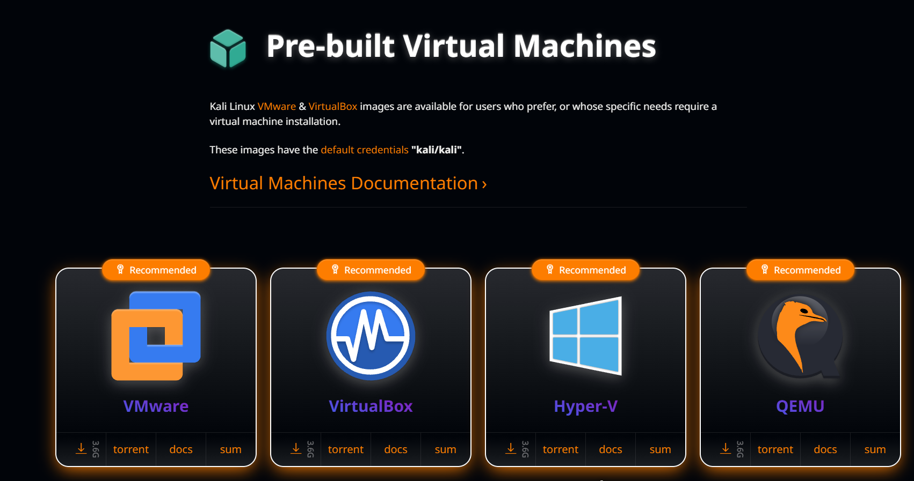

### 2. Open Oracle VirtualBox

Oracle VirtualBox was already installed on my computer. The screenshot also shows a Kali Linux virtual machine from a previous project.

**Screenshot 2 — Oracle VirtualBox**

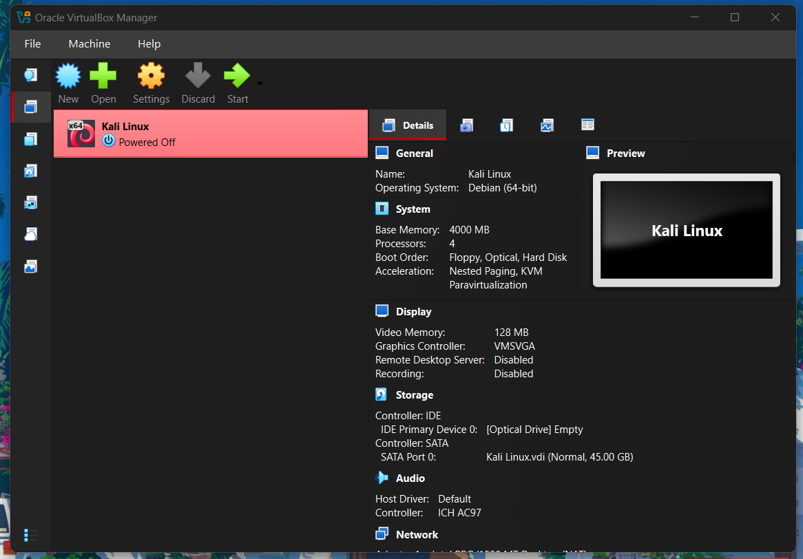

### 3. Import the Kali Linux virtual machine

I imported the pre-built Kali Linux virtual machine into Oracle VirtualBox. This virtual machine would be used for cybersecurity learning, penetration-testing practice, and lab testing.

**Screenshot 3 — Imported Kali Linux virtual machine**

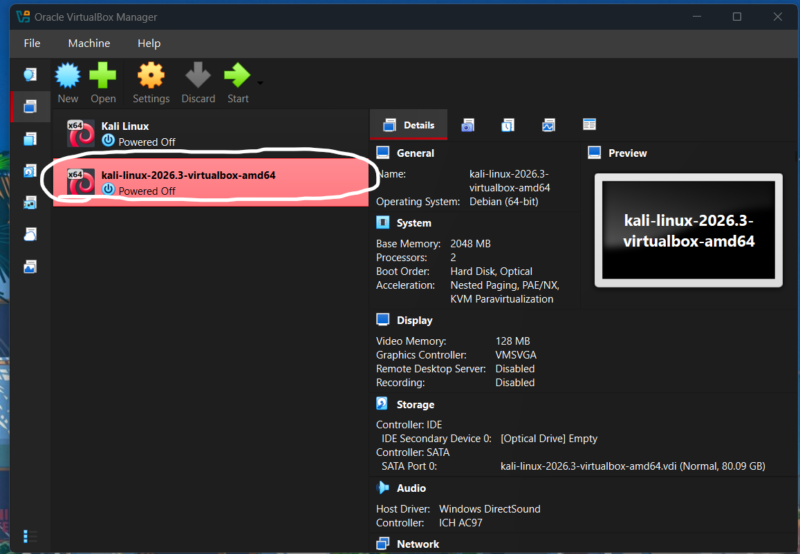

### 4. Create the NAT Network

I created a NAT Network in Oracle VirtualBox and named it `NatNetwork`. The network uses the `10.0.0.0/24` subnet.

**Screenshot 4 — NAT Network configuration**

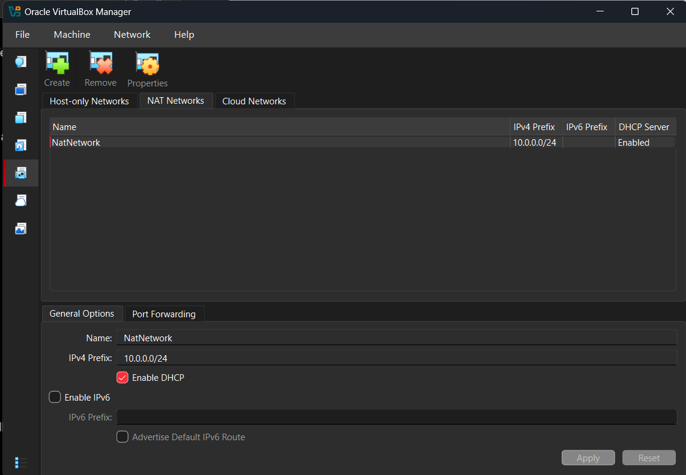

### 5. Configure virtual machine resources

I configured the virtual machine's hardware resources before starting it.

**Screenshot 5 — Memory allocation: 4,000 MB**

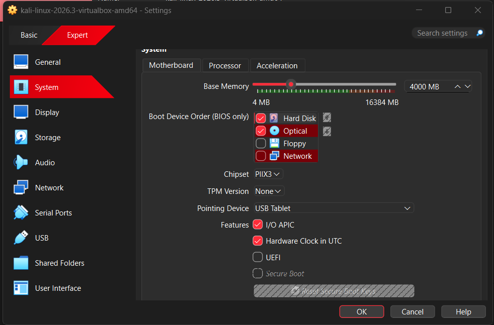

**Screenshot 6 — Processor Allocation: 4 CPUs**

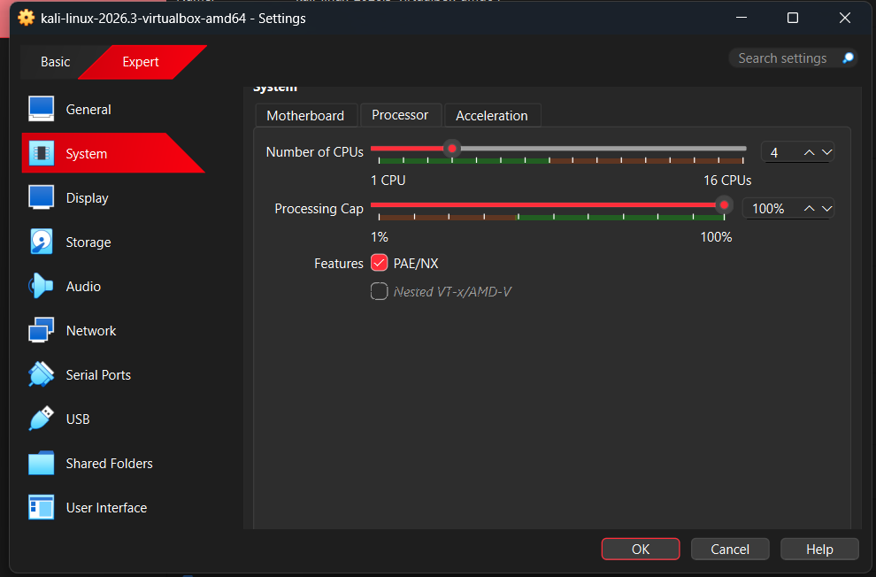

**Screenshot 6 — Video Memory: 128 MB**

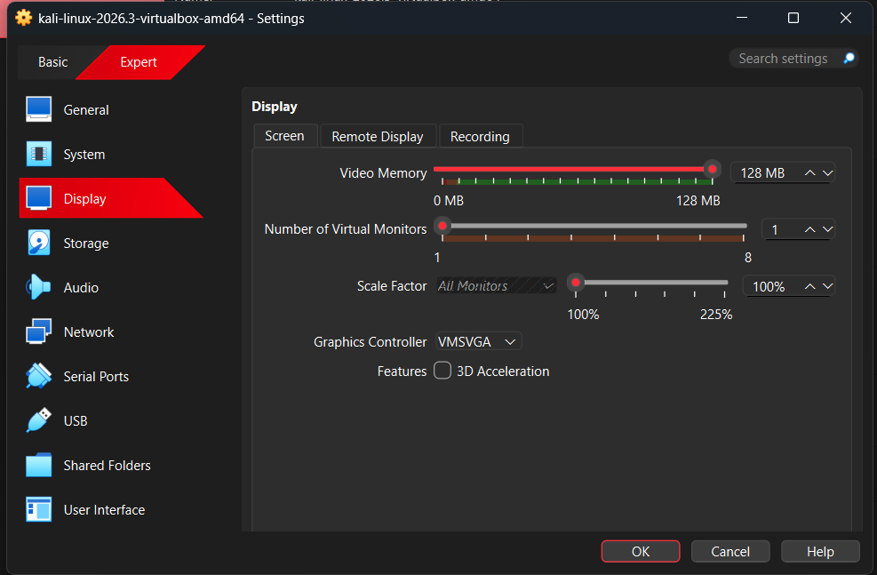

### 6. Configure the network adapter

I configured the Kali Linux virtual machine's network adapter to use the `NatNetwork` NAT Network created earlier.

**Screenshot 8 — Virtual machine network adapter**

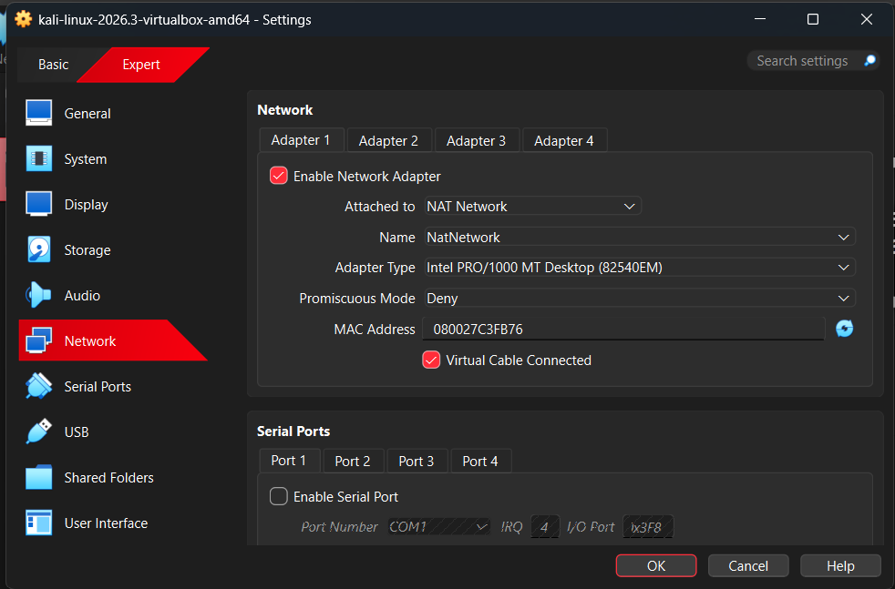

### 7. Configure the shared folder

I configured a shared folder between the Windows host and Kali Linux, using the Windows Downloads directory.

**Screenshot 9 — Shared folder configuration**

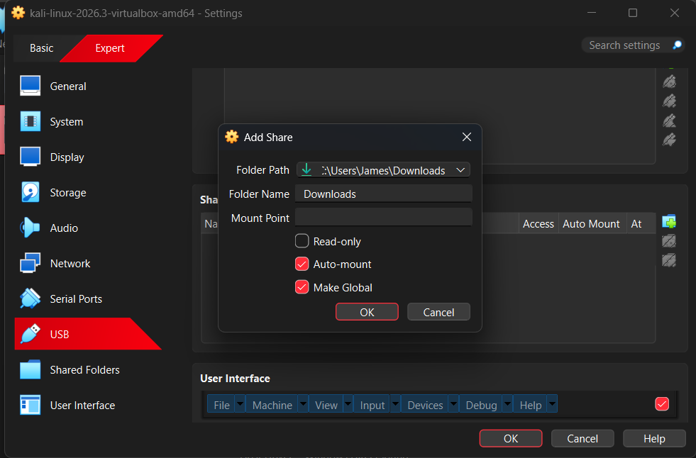

### 8. Start Kali Linux

After completing the initial virtual machine configuration, I started Kali Linux to continue with the network setup.

**Screenshot 10 — Kali Linux successfully started**

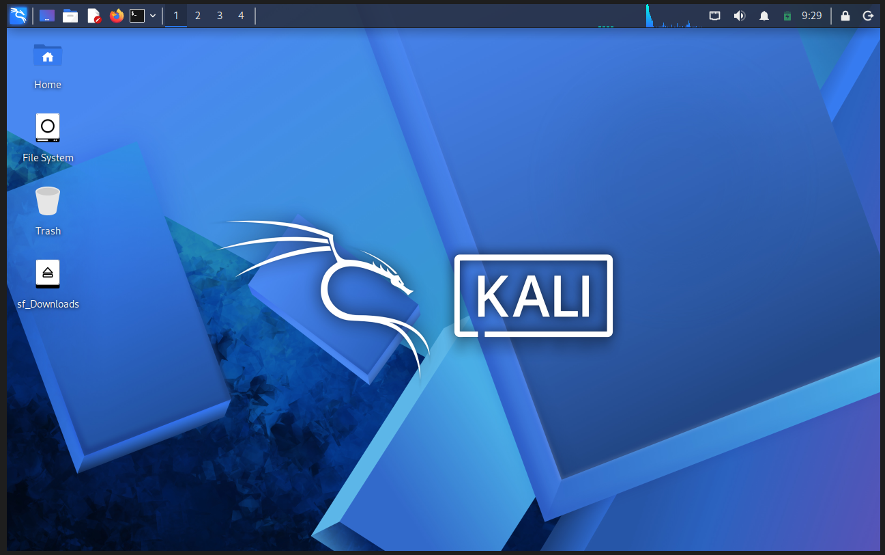

### 9. Configure a static IPv4 address

I manually configured the IPv4 network settings in Kali Linux using the following values:

| Setting | Value |
|---|---|
| IP address | `10.0.0.2` |
| Subnet mask | `255.255.255.0` |
| Default gateway | `10.0.0.1` |
| DNS server | `8.8.8.8` |

**Screenshot 11 — Manual IPv4 configuration**

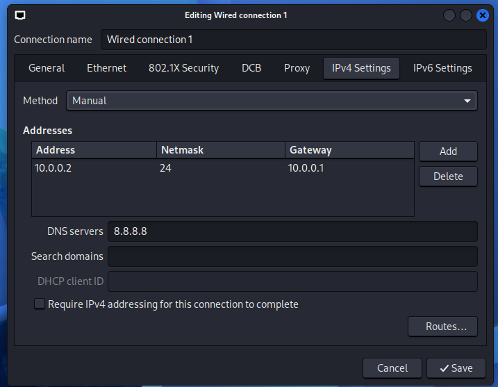

---

## Network Connectivity Verification

After configuring the network, I ran several commands to check that Kali Linux had the expected network settings and could communicate with the gateway and the internet.

The checks covered:

1. The assigned IP address.
2. The default gateway.
3. Connectivity to the default gateway.
4. External network connectivity.
5. DNS resolution.
6. Internet access through the web browser.

### 1. Verify the IP address

I used `ip a` to inspect the network interfaces and confirm the IP address assigned to Kali Linux.

```bash
ip a
```

**Screenshot 12 — IP address verification**

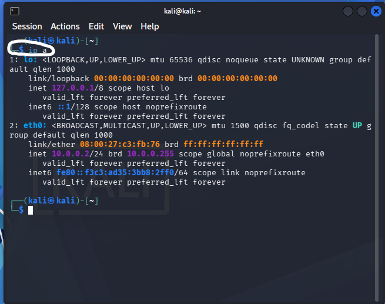

### 2. Verify the default gateway

I used `ip route` to inspect the routing table and check the configured default gateway.

```bash
ip route
```

**Screenshot 13 — Routing table and default gateway**

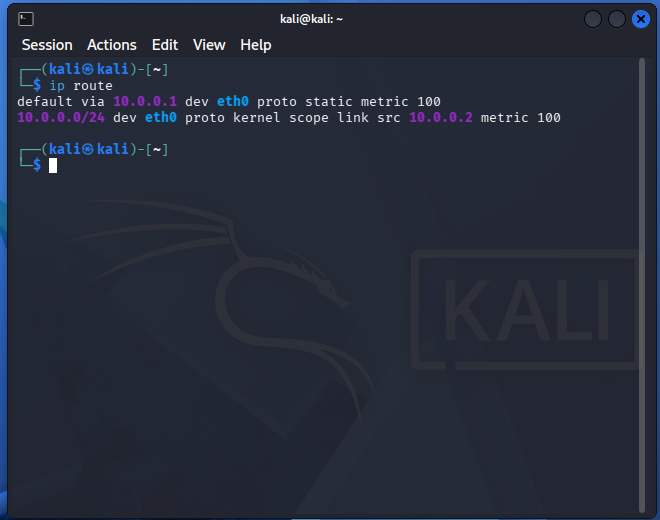

### 3. Test connectivity to the gateway

I used `ping` to check whether Kali Linux could communicate with its default gateway.

```bash
ping 10.0.0.1
```

**Screenshot 14 — Gateway connectivity test**

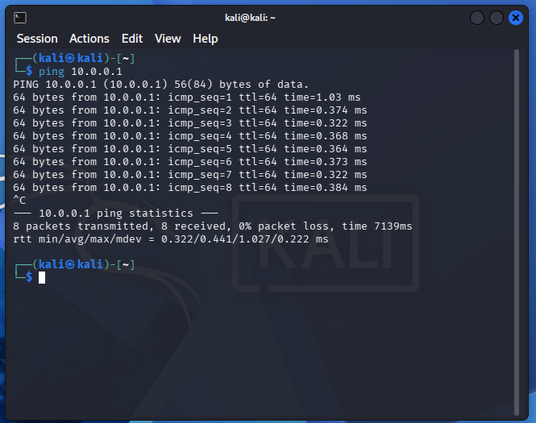

### 4. Test external connectivity

I sent ping requests to Google's public DNS server to test connectivity to an external IP address.

```bash
ping 8.8.8.8
```

**Screenshot 15 — External connectivity test**

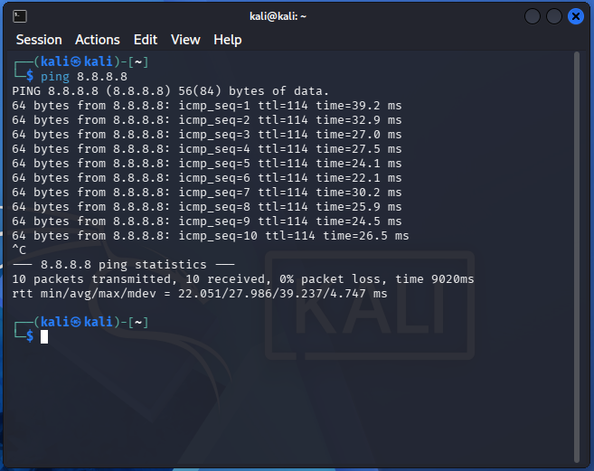

### 5. Test DNS resolution

I used `nslookup` to check whether Kali Linux could resolve a domain name to an IP address.

```bash
nslookup google.com
```

**Screenshot 16 — DNS resolution test**

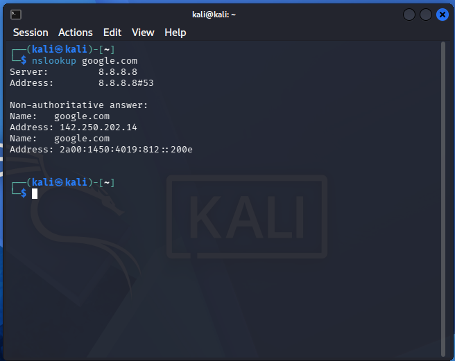

### 6. Verify internet access in the browser

Finally, I opened YouTube in the Kali Linux browser to visually confirm that internet access was working.

**Screenshot 17 — Internet access through the Kali Linux browser**

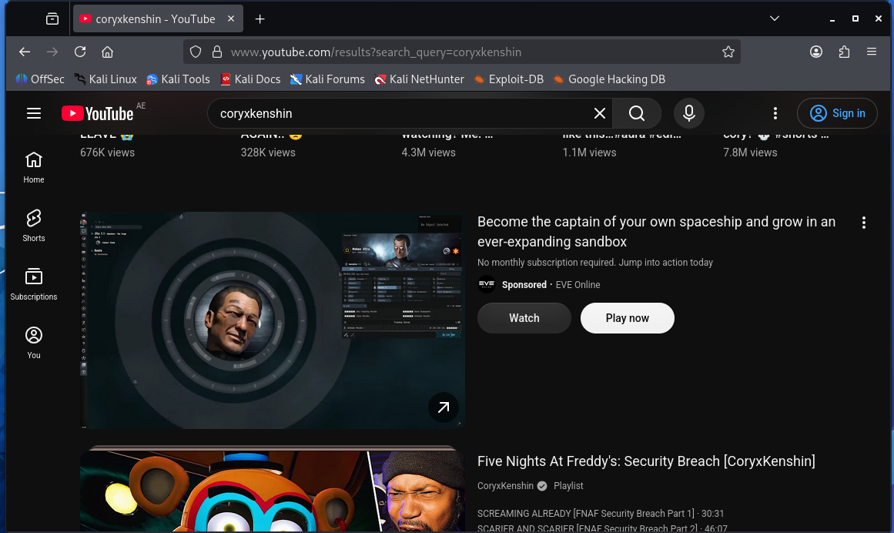

---

## Shared Folder Verification

To test the shared-folder configuration, I created a test folder in the Windows Downloads directory. I then checked whether the folder could also be accessed from Kali Linux.

The test folder was named:

`If you see this folder, that means that it worked!`

### 1. Create the test folder on Windows

The screenshot below shows the test folder inside the Windows Downloads directory.

**Screenshot 18 — Test folder in Windows Downloads**

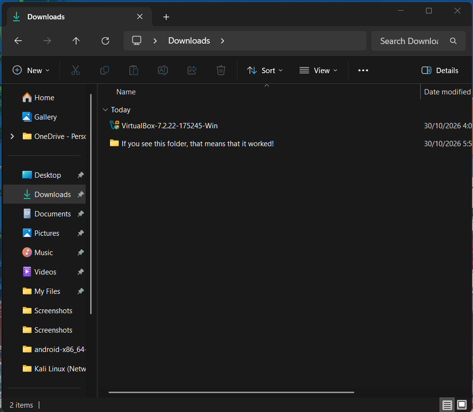

### 2. Access the shared folder from Kali Linux

I used the Kali Linux terminal to check that the shared folder and its contents were accessible.

**Screenshot 19 — Shared folder accessed from Kali Linux**

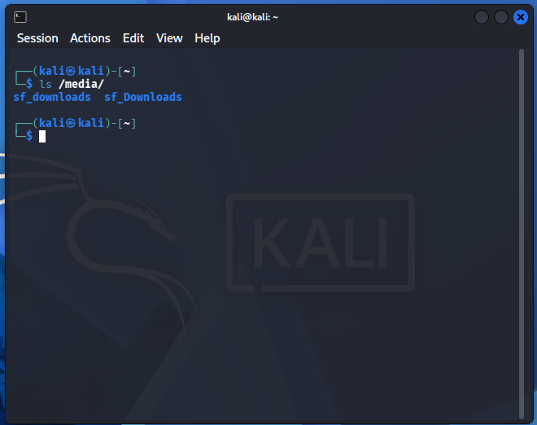

### 3. Compare the Windows and Kali Linux views

The final screenshot compares the folder in Windows with the corresponding shared folder accessed from Kali Linux.

**Screenshot 20 — Shared folder comparison**

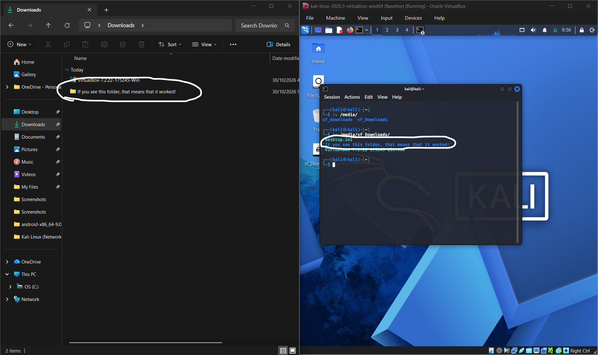

---

## Troubleshooting

Most of the setup process went smoothly. However, I encountered a network connectivity issue after manually configuring the IPv4 settings in Kali Linux. The virtual machine could not access the internet, and websites would not load in the browser.

### Solution

To troubleshoot the issue, I used NetworkManager's command-line utility, `nmcli`, to change the IPv4 Duplicate Address Detection (DAD) timeout setting and then restart the network connection.

I ran the following commands:

```bash
sudo nmcli connection modify "Wired connection 1" ipv4.dad-timeout 0

sudo nmcli connection down "Wired connection 1"

sudo nmcli connection up "Wired connection 1"
```

### Command breakdown

| Command / Parameter | Explanation |
|---|---|
| `sudo` | Runs the command with administrator privileges. |
| `nmcli` | NetworkManager's command-line utility. |
| `connection modify` | Changes the settings of an existing network connection profile. |
| `ipv4.dad-timeout 0` | Sets the IPv4 Duplicate Address Detection timeout to zero. |
| `connection down` | Deactivates the specified network connection. |
| `connection up` | Reactivates the network connection using its configured settings. |

### Result

After running these commands, network connectivity was restored, and I could access websites through the Kali Linux browser. This resolved the issue and allowed me to complete the remaining configuration and verification steps.

---

## What I Learned

Building this lab gave me practical experience with virtualisation, Linux networking, and configuring a basic cybersecurity testing environment.

Some of the key things I learned were:

- **Virtualisation:** How to import, configure, and manage a Kali Linux virtual machine using Oracle VirtualBox.
- **Network configuration:** How to create a NAT Network, assign a static IPv4 address, and configure a default gateway and DNS server.
- **Linux networking:** How to use commands such as `ip a`, `ip route`, `ping`, and `nslookup` to inspect and test network connectivity.
- **Troubleshooting:** How to investigate a connectivity issue and use NetworkManager commands to restore the network connection.
- **Host and virtual machine integration:** How to configure shared folders, shared clipboard, and drag-and-drop between Windows and Kali Linux.
- **Technical documentation:** How to record configurations, troubleshooting steps, and verification results with screenshots.

Most importantly, this project helped me understand how the different components of a virtual lab environment work together. It also gave me a foundation for future hands-on exercises involving penetration testing and cybersecurity assessments.

## References

The following official resources were used during the setup process:

1. [Kali Linux — Official Download Page](https://www.kali.org/get-kali/#kali-platforms)
2. [Oracle VirtualBox — Official Downloads](https://www.virtualbox.org/wiki/Downloads)

---

**Project status:** Completed  
**Environment:** Windows 11 · Oracle VirtualBox · Kali Linux
